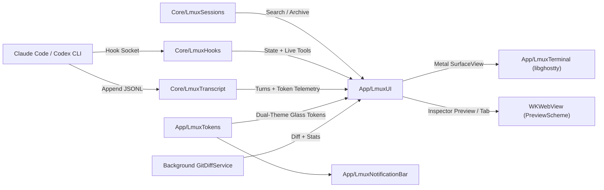

# lmux — Architecture

Native macOS terminal multiplexer built directly on Swift/AppKit/libghostty (`App/`) paired with lightweight non-wrapping agent telemetry libraries (`Core/`). Terminals render via pure Metal without web wrappers, while sidebars, Inspector panels, and preview tabs follow Apple Liquid Glass ergonomics.

## Diagram

## Modules

| Module | Purpose | Docs / Reference |
|---|---|---|
| `Core/LmuxHooks` | Hook IPC socket, Codex/Claude state machine & live tool stream | [HookEvent.swift](../Core/Sources/LmuxHooks/HookEvent.swift) |
| `Core/LmuxTranscript` | Incremental Claude JSONL & Codex rollout parser (turns, usage telemetry) | [FORMAT.md](../Core/Sources/LmuxTranscript/FORMAT.md) |
| `Core/LmuxSessions` | SQLite session FTS index & archive cleanup protection | [SessionIndex.swift](../Core/Sources/LmuxSessions/SessionIndex.swift) |
| `App/LmuxTokens` | Dual-theme Liquid Glass colors, typography, layout & contrast tokens | [App README](../App/README.md) |
| `App/LmuxTerminal` | libghostty Metal runtime & terminal surface wrapper | [GhosttyRuntime.swift](../App/Sources/LmuxTerminal/GhosttyRuntime.swift) |
| `App/LmuxUI` | Three-column chrome, panes/tabs, Right Inspector, Window Footer & Git diff | [App README](../App/README.md) |
| `App/LmuxNotificationBar` | Collapsible notification drawer, resize pill & glass cards | [notification-bar](features/notification-bar/README.md) |

## Constraints

- **Never wrap agents**: `Core/` observes via opt-in hooks and read-only incremental file parsing (`docs/adr/0004-hybrid-hook-and-jsonl-telemetry.md`).
- **Dual-track preview**: Right Inspector serves instant preview by default while `Pane.Content` keeps split preview tabs (`docs/adr/0001-pane-surface-optional.md`, `docs/adr/0002-dual-track-inspector-preview.md`).
- **Single-layer panel blur**: Only chrome panels mount `NSVisualEffectView`, pausing blur during drags (`docs/adr/0003-single-backdrop-glass-simulation.md`).
- **Isolated tests**: `apptest` runs offscreen/isolated; Ghostty terminal rendering never embeds SwiftUI.
