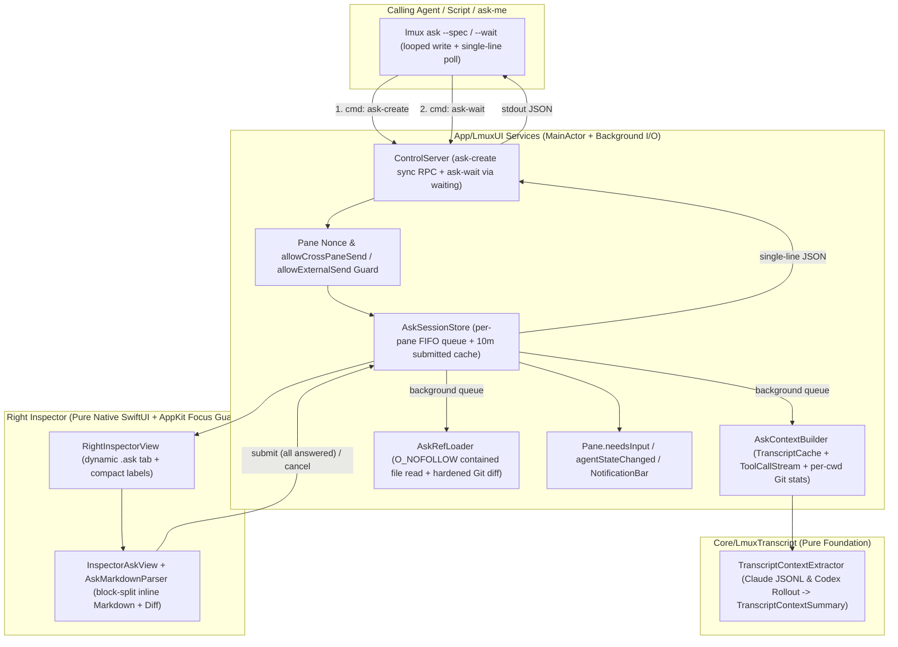

# 右側 Inspector 原生問答面板與零 Token Session 上下文補充 — 技術設計

## Approach

本設計在既有 `feat/preview-liquid-glass` 三欄 Apple Liquid Glass 工作台與 `ControlServer` 基礎上，新增三條協作管線，全程維持「零 HTML／零 WebView、零額外 LLM Token、不干預 `lmux-hook`、嚴格租戶與路徑隔離」的核心原則：

### 1. 問答工作階段狀態機與權限隔離（`AskSessionStore`）

每個由 `lmux ask` 建立的 **問答工作階段** 擁有以 128-bit CSPRNG（`LmuxController.randomToken()`，32 字元 hex）產生的 `sessionId`，並綁定驗證後的來源終端機 `ownerPaneID`：

```mermaid
stateDiagram-v2
  [*] --> pending: ask-create (authorized & spec valid)
  pending --> pending: ask-wait client timeout / hangup (detaches socket callback only; UI stays open)
  pending --> pending: lmux ask --wait <id> (authorized; supersedes any stale waiter & attaches callback)
  pending --> submitted: User answers all questions & submits in 待確認面板
  pending --> cancelled: User clicks 取消
  pending --> lost: Source terminal tab closed or lmux quits (ControlServer.stop -> gone)
  submitted --> [*]: Single-line JSON sent to attached waiter (or cached 10m for subsequent --wait)
  cancelled --> [*]: Single-line {status: cancelled, note: ...} sent (or cached 10m) & removed from UI
  lost --> [*]: Single-line {status: lost} / {gone: true} sent & removed
```

- **`control.sock` 授權與租戶隔離（對齊 `Controller.send`）**：
  - **`ask-create`**：
    1. 若請求攜帶有效 `LMUX_PANE_NONCE`（`pane(token:)` 解析為 `P`）：未帶 `--pane` 時目標即 `P`；若指定 `--pane Q` 且 `Q != P`，必須開啟 `allowCrossPaneSend`，否則拒絕。
    2. 若無有效 pane token：必須開啟 `allowExternalSend`（`apptest` 已支援 `LMUX_ALLOW_EXTERNAL_SEND=1`），且若 `callerPane(token: nil, peerPID:)` 指向另一個 pane 仍拒絕跨區偽造；目標預設為 `--pane` 或目前選取 workspace 的 focused terminal pane。
    3. 目標必須是 **終端機 tab**（`target.surface != nil`），拒絕 **預覽 tab**。
  - **`ask-wait`**：必須通過與建立時相同的授權檢查（若該工作階段由 pane 建立，呼叫端必須持有該 `ownerPaneID` 的有效 token 或開啟 `allowCrossPaneSend`；若由外部建立則需 `allowExternalSend`），防止本機其他程序透過 `ps` 看到 `--wait <sessionId>` 搶領或偷讀使用者的回答。若同一 `sessionId` 已有舊 waiter 掛著，先安全通知／關閉舊 waiter 再掛上新連線，絕不洩漏 `ControlServer.waiting` fd。
- **同 pane FIFO 佇列與短期結果快取**：
  - `AskSessionStore` 依 `paneID` 維護陣列（FIFO），預設顯示該 tab 第一筆 `pending` 工作階段（多筆時於頁首顯示 `1 / N` 指示），不靜默覆蓋草稿。
  - 若使用者在呼叫端逾時斷線後、執行 `--wait` 前按了送出或取消，結果在記憶體保留最多 10 分鐘（上限 32 筆），讓隨後的授權 `ask-wait` 立即領回並清除。

### 2. 兩階段單行 Socket 協議與 `lmux-cli` 強化（`ControlServer.swift` + `lmux-cli/main.swift`）

為百分百遵守 `ControlServer`「一條連線一行 JSON 請求、一行 JSON 回應」的不變量（避免雙行黏包造成 `JSONSerialization` 失敗與雙 `DispatchSourceWrite` 競爭）：

1. **階段一（同步建立）**：`lmux ask --spec` 先送出 `{"cmd": "ask-create", "spec": <object>, "lenient": <bool>, "pane": ..., "token": ...}`，由 `handleControl` 同步驗權、正規化 spec、建立 `pending` 工作階段並觸發背景上下文與引用載入，立即回傳單行 `{"ok": true, "sessionId": "<id>"}` 並關閉連線。
2. **階段二（長連線等待）**：`lmux ask --spec` 隨即以該 `<id>` 發起第二條連線 `{"cmd": "ask-wait", "sessionId": "<id>", "token": ...}`（與 `lmux ask --wait <id>` 共用完全相同的函式！），走 `ControlServer` 長連線 `waiting` 通道：
   - Client 端以 `poll()` 計時 `--timeout`（預設 `540` 秒，範圍 `1...3600`）；逾時未收到回覆時，直接關閉 fd 並於 stdout 印出 `{"status":"pending","sessionId":"<id>","resume":"lmux ask --wait <id>"}`（exit `0`）。Server 端 `readWaiting` 偵測到 EOF 時僅解除該 `sessionId` 的 reply closure，**保留** `pending` 工作階段。
   - App 結束時 `ControlServer.stop()` 寫出既有的 `{"ok":true,"gone":true}\n`，CLI 將 `gone == true` 轉印為 `{"status":"lost","sessionId":"<id>","note":"lmux 已結束或來源分頁已關閉。"}`（exit `0`）。
3. **修復 `lmux-cli` 大型請求截斷**：將 `connectAndSend` 中的單次 `write()` 改為完整迴圈寫入（處理 `EINTR`，寫入失敗則報錯離開），確保超過 macOS Unix domain socket 預設 8KB 緩衝區的 spec JSON 不被截斷（上限仍受 `ControlServer.maxRequestBytes = 1 MB` 保護）。

### 3. 與 `ask-me` 完全對齊的 Spec 正規化與輸出契約（`AskSpec.swift`）

- **Spec 檢核與正規化**：
  - `questions` 必填且數量 `1...12`；每題 `question` 去空白後非空；每題 `id` 預設 `q1`, `q2`...，**嚴格拒絕重複 `question.id`**。
  - 選項相容字串簡寫（`["方案 A", "方案 B"]`）與物件（`{label, description, recommended}`）；自動識別並剝除 `label` 尾端的 `(Recommended)` / `（推薦）` / `（建議）` 標記並設 `recommended = true`（作答回傳剝除後的乾淨 `label`）；**嚴格拒絕單題內重複的正規化 `label`**。
  - **防偷懶字數把關**：預設與 `ask-me` 一致，要求 `intro` 去空白後至少 25 字元，且含 `options` 的題目 `detail` 至少 20 字元（引導模型交代脈絡與代價）；另提供 `--lenient` 旗標（僅要求 `intro` 與 `question` 非空）供簡易 shell 腳本或 `direct` 降級路徑使用。
  - **全題必答規則**：每道題目必須「至少勾選一個選項」或「填寫非空白 `freeText`」才算已作答；全部題目皆已作答後，送出按鈕與 `⌘↩` 才會送出表單。
- **Stdout JSON 與 Exit Code**：
  - `submitted`：`{"status":"submitted","sessionId":"...","answers":[{"id":"...","header":"...","question":"...","selected":["..."],"freeText":"..."}]}`（`header` 與 `freeText` 無值時固定為 `""`）
  - `pending`：`{"status":"pending","sessionId":"...","resume":"lmux ask --wait <id>"}`
  - `cancelled`：`{"status":"cancelled","sessionId":"...","note":"使用者在待確認面板點選取消；請勿立即重開相同問題，先在終端機確認使用者意圖。"}`
  - `lost`：`{"status":"lost","sessionId":"...","note":"來源終端機分頁已關閉或問答工作階段已失效。"}`
  - 上述四種生命週期 JSON 皆印至 stdout 並以 **exit `0`** 結束；spec 驗證失敗、檔案讀取失敗、未授權或 socket 斷線則輸出錯誤至 stderr 並以 **exit `1`** 結束；CLI 旗標語法錯誤為 **exit `2`**。

### 4. 零 Token 本地 Session 上下文抽取（`Core/LmuxTranscript` + `App/LmuxUI`）

遵守 `Core/Package.swift` 模組邊界（`LmuxTranscript` 僅依賴 `LmuxPrivateFile`，不引入 `LmuxHooks` 或 `LmuxUI`），拆成兩層組裝 **Session 上下文補充**：

1. **`Core/Sources/LmuxTranscript/TranscriptContextExtractor.swift`**：
   - 在 `TranscriptIndex` 標記 `message.model == "<synthetic>"` 的節點不納入回覆摘要（不影響既有 `TurnLocator` 行定位），並於 `CodexRollout` 補齊從 rollout 工具／patch 項目抽取異動檔案路徑至 `Turn.editedFiles`／`createdFiles`。
   - 輸入標題（`customTitle`、`aiTitle`／Codex `withTitle: true` 取得的 `threadName`）與 `[TranscriptIndex.Turn]`，純函數產出 `TranscriptContextSummary`：`sessionTitle`、`initialGoal`（首輪 prompt 精簡摘要）、`recentTurns`（最近 3 輪非重複之 prompt 與非合成回覆重點）、`touchedFiles`（最近 5 輪去重之異動與新建檔案）。
2. **`App/Sources/LmuxUI/AskContextBuilder.swift`**：
   - 透過 `controller.transcripts`（嚴格在 `TranscriptCache.queue` 執行緒安全讀取）取得最新 `TranscriptContextSummary`。
   - 合併來源 `pane.agent.toolStream.entries.suffix(5)`。
   - **針對來源 `pane.cwd` 獨立取得 Git 摘要**：僅在 `model.gitDiffService.snapshot.cwd == pane.cwd` 時直接複用快取，否則在背景對 `pane.cwd` 執行輕量安全狀態查詢，絕不將當前選取 workspace A 的分支與變更誤貼到背景 workspace B 的提問上。
- **呈現策略**：若 `--lenient` 或 `intro` 較短，**Session 上下文補充** 卡片預設展開；否則預設顯示單行摘要列（任務標題、近期異動檔數、最近一輪進度）供一鍵展開。

### 5. 安全本機引用載入（`AskRefLoader.swift`）

- **`refs`（`path[:startLine[-endLine]]`，每題上限 8 筆）**：
  - 基準目錄為來源 pane 的 `repoRoot ?? pane.cwd`。複用 `GitDiffService` 同等級防護：先驗證 `resolvingSymlinksInPath()` 嚴格位於基準目錄內，再以 `Darwin.open(canonicalPath, O_RDONLY | O_NOFOLLOW | O_NONBLOCK)` 開啟、`fstat` 確認為一般檔案（`S_IFREG`，拒絕 FIFO／device）、限制讀取上限（512 KB）並拒絕含 NUL 位元組之二進位檔；單段最多截取 120 行。
  - 點擊引用檔名時：先經 `PreviewTarget.resolve` 檢查，可預覽者載入「即時預覽」；若為無副檔名或系統未歸類 `public.text` 之檔案（如 `Makefile`、`.toml`），擴充 `PreviewTarget` 常見純文字檔名／副檔名白名單，仍不支援者顯示友善提示而不靜默失效。
- **`gitDiff`（相對路徑，每題上限 8 筆）**：
  - 直接共用 `GitDiffService` 的硬化執行環境（`filterOverrideEnv` 中和所有 `filter.*`、清空 `GIT_EXTERNAL_DIFF`/`GIT_ALLOW_PROTOCOL`、支援無初始提交之 unborn `HEAD` 與未追蹤新檔 `readUntrackedLines` fallback），再交由 `GitDiffParser` 產生紅綠差異行。

### 6. 純原生 SwiftUI「待確認面板」、Markdown 分塊與 AppKit 焦點／快捷鍵防護

- **動態頁籤與窄視窗適配（`RightInspectorView.swift`、`RootView.swift`、`Persistence.swift`）**：
  - `InspectorTab` 新增 `.ask`；`AppModel` 維護 `lastNonAskInspectorTab`（持久化於 `layout.json`，絕不把 `.ask` 寫入磁碟）與 `inspectorAutoOpenedByAsk: Bool`。
  - 當 `.ask` 頁籤顯示（共 4 頁籤）或 Inspector 寬度 `< 340pt` 時，頁籤列自動切換為緊湊標籤（`待確認`、`預覽`、`Diff`、`記錄`）並收斂非選中圖示，確保在最小寬度 `240pt` 下完整可讀。
  - 窄視窗下 `RootView.layout()` 在隱藏右側欄前，先將有效寬度彈性夾緊至 `max(240, min(inspectorWidth, W - effectiveSw - 120))`，盡可能保留 **待確認面板** 可見。
- **全路徑注意力與分頁同步（`Model.swift`、`Controller.swift`、`Wait.swift`）**：
  - `Pane.hasPendingAsk` 變更時觸發 `agentStateChanged()`（更新 `stateChangedAt` 並喚醒 `lmux wait --until needs-you`／`any`）；`Pane.display` 中 `hasPendingAsk` 優先序高於 `.running`（讓正在執行 `Bash(lmux ask)` 的 tab 正確顯示 `🔔 需要確認`）；`Pane.needsInput` 納入 `hasPendingAsk`（支援 `⌘⇧J`、未聚焦琥珀光環與分頁圓點，且 `Controller.userTyped` 不會清除 `hasPendingAsk`）。
  - 集中於 `Controller.syncInspectorForFocusedPane()` 處理所有焦點切換路徑（點選 workspace、切換 tab、點擊 **通知卡片**、系統通知喚醒、`⌘⇧J`）：切到有 pending ask 的 tab 自動顯示 `.ask`；切到無 pending ask 的 tab（或送出／取消最後一筆後）立即退回 `lastNonAskInspectorTab`（若當初為自動展開則還原收合）。
- **原生分塊 Markdown 與 Mermaid 程式碼卡（`AskMarkdownParser.swift`、`InspectorAskView.swift`）**：
  - 因 macOS `AttributedString(markdown:)` 預設 `.full` 交給 `SwiftUI.Text` 會抹除段落與清單換行，`AskMarkdownParser` 先按區塊切分為 `heading`、`paragraph`、`bulletItem`、`numberedItem`、`blockquote`、`codeBlock`、`diffBlock`，各區塊行內使用 `.inlineOnlyPreservingWhitespace` 渲染，並透過 `.environment(\.openURL)` 轉交 `GhosttyRuntime.openTerminalURL` 安全檢查。
  - `mermaid` 欄位渲染為可折疊等寬程式碼卡＋「複製語法」按鈕，完全不啟動 `WKWebView`，也不污染 `WorkspacePreviewCoordinator` 的目前預覽檔。
- **AppKit 鍵盤焦點與選單快捷鍵防護（`Controller.swift`、`Menu.swift`、`SidebarSelection.swift`）**：
  1. **文字編輯快捷鍵**：當 `window.firstResponder is NSText` 時，`validateMenuItem` 停用 `menuUndoSend`，並在 Edit 選單提供／路由標準文字 `Undo (⌘Z)`、`Redo (⇧⌘Z)`、`Cut (⌘X)` 至現行 `NSText`／`UndoManager`，避免打字按 `⌘Z` 誤觸 Claude Rewind。
  2. **`⌘↩` 攔截不漏入 PTY**：在 `LmuxWindow.performKeyEquivalent` 中，當 **待確認面板** 可見且 `focusedPane` 有待答工作階段時直接攔截 `⌘↩`——若全題已作答則送出，若有未答題目則發出提示音並捲動聚焦至第一道未答題，**絕不讓 `⌘↩` 穿透進 `SurfaceView` 終端機**。
  3. **失焦與隱藏安全歸還**：`Controller.ensureFocus()` 對 `rightInspectorHost` 內 `NSText` 的保留條件嚴格限制為 `model.inspectorVisible && !rightInspectorHost.isHidden && model.inspectorTab == .ask`；一旦切離 `.ask`、按 `⌥⌘B` 收合或視窗過窄自動隱藏，立即（並搭配下一輪 runloop `DispatchQueue.main.async`）呼叫 `focusCurrent()` 將焦點歸還終端機。

---

## Key Decisions

1. **純原生 SwiftUI + 兩階段 `ControlServer` RPC，不內嵌 WebView 也不介入 `lmux-hook`** — 見 [docs/adr/0005-native-inspector-ask-cli.md](../../../docs/adr/0005-native-inspector-ask-cli.md)。
2. **`ask-create` + `ask-wait` 雙連線取代單連線雙行串流**：完全契合 `ControlServer` 與 `lmux-cli` 的單行 JSON framing，消除黏包解析失敗與雙 `DispatchSourceWrite` 競爭，並讓 `--spec` 與 `--wait` 共用同一套等待與權限檢核邏輯。
3. **純本地零 Token 抽取並嚴守 `Core` 模組邊界**：`Core/LmuxTranscript` 負責無 UI 依賴的對話脈絡抽取（同時補齊 Codex 異動檔與 `<synthetic>` 過濾），`App/LmuxUI` 再結合 `ToolCallStream` 與按 `pane.cwd` 隔離的 Git 統計。
4. **`Pane.hasPendingAsk` 高於 `.running` 並整合 `needsInput`／`lmux wait`**：解決 Agent 在 `Bash` 工具執行期間狀態為 `.running` 卻實際阻塞等待使用者決策的矛盾，同時不污染 `PaneAgent` 的 hook 狀態機。

---

## Components

| 檔案 / 模組 | 職責與改動重點 |
|---|---|
| `Core/Sources/LmuxTranscript/TranscriptContextExtractor.swift`、`TranscriptIndex.swift`、`CodexRollout.swift` | 產出純值型別 `TranscriptContextSummary`（任務起點、近期輪次摘要、異動檔案）；過濾 Claude `<synthetic>` 摘要並補齊 Codex 異動檔案抽取。 |
| `App/Sources/LmuxUI/AskSpec.swift`、`AskSessionStore.swift`、`AskContextBuilder.swift` | 實作對齊 `ask-me` 的 Spec 正規化／防偷懶檢核、128-bit `sessionId`、per-pane FIFO 佇列、10 分鐘答案快取，以及結合 `TranscriptCache`＋`ToolCallStream`＋per-cwd Git 的上下文組裝。 |
| `App/Sources/LmuxUI/AskRefLoader.swift`、`GitDiffService.swift`、`PreviewTarget.swift` | 複用 `O_NOFOLLOW` 邊界檢查與 `filterOverrideEnv` 安全讀取 `refs` 與 `gitDiff`（含 unborn HEAD 與未追蹤檔支援），擴充常見無副檔名純文字預覽白名單。 |
| `App/Sources/LmuxUI/AskMarkdownParser.swift`、`InspectorAskView.swift` | 分塊解析 Markdown／紅綠 Diff／Code（行內 `.inlineOnlyPreservingWhitespace`＋安全連結攔截），實作 Liquid Glass **待確認面板**（**Session 上下文補充**、題目卡、引用卡、Mermaid 複製卡、全題必答檢核）。 |
| `App/Sources/LmuxUI/ControlServer.swift`、`Controller.swift`、`Model.swift`、`Menu.swift`、`SidebarSelection.swift`、`RightInspectorView.swift`、`RootView.swift`、`Persistence.swift` | 實作 `ask-create`／`ask-wait` 與 `LMUX_PANE_NONCE` 驗權、`hasPendingAsk` 優先序與 `lmux wait` 連動、`syncInspectorForFocusedPane()`、緊湊頁籤與窄視窗夾緊、`NSText` 編輯快捷鍵（`⌘Z`/`⇧⌘Z`/`⌘X`）及 `⌘↩` 防穿透攔截。 |
| `App/Sources/lmux-cli/main.swift`、`skills/lmux/SKILL.md` | 修復 `connectAndSend` 迴圈寫入，實作 `lmux ask --spec <path|-> [--lenient]` 與 `lmux ask --wait <id>`，更新內建 skill 文件。 |
| `Core/Tests/LmuxTranscriptTests/TranscriptContextExtractorTests.swift`、`App/Sources/lmux-apptest/InspectorAskTests.swift` | 涵蓋 Claude/Codex 上下文抽取、Spec 正規化、跨 pane 未授權阻擋、`O_NOFOLLOW`/filter 安全防護、大 payload 寫入、逾時續等、AppKit `⌘Z`/`⌘↩`/失焦歸還與多工作區通知測試。 |
