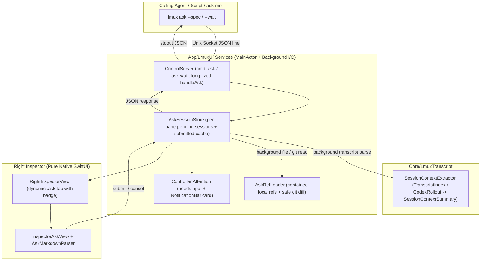

# 右側 Inspector 原生問答面板與零 Token Session 上下文補充 — 技術設計

## Approach

本設計在既有 `feat/preview-liquid-glass` 三欄 Apple Liquid Glass 工作台與 `ControlServer` 長連線等待基礎上，新增三條協作管線，全程維持「零 HTML／零 WebView、零額外 LLM Token、不干預 `lmux-hook`」的核心原則：



### 1. 問答工作階段狀態機（`AskSessionStore`）

每個由 `lmux ask` 建立的 **問答工作階段** 都有唯一的 `sessionId` 並綁定來源 `paneID`（若外部呼叫未帶合法 pane token，則可綁定 `--pane` 指定的 pane 或目前選取 workspace 的 focused pane）：

```mermaid
stateDiagram-v2
  [*] --> pending: lmux ask --spec (validated)
  pending --> pending: CLI timeout / disconnect (returns pending + resume; UI stays open)
  pending --> pending: lmux ask --wait <id> (re-attaches reply callback)
  pending --> submitted: User submits answers in 待確認面板
  pending --> cancelled: User clicks 取消
  pending --> lost: Source tab closed or lmux quits
  submitted --> [*]: Reply sent to waiting CLI (or cached 10m for late --wait)
  cancelled --> [*]: Reply {status: cancelled} sent & removed
  lost --> [*]: Reply {status: lost} sent & removed
```



- **同 pane 多工作階段不覆蓋**：`AskSessionStore` 依 `paneID` 維護陣列（FIFO 佇列），預設顯示該 tab 最早一筆尚未處理的 `pending` 工作階段（若同時超過 1 筆，頁首顯示切換列如 `1 / 2`），避免同一個 tab 的子任務或重試靜默覆蓋使用者寫到一半的草稿。
- **無連線送出的答案快取**：若前一次 `lmux ask` 因逾時先回傳 `pending`，使用者在呼叫端執行 `--wait` 之前就先按了送出，`AskSessionStore` 會將 `submitted` 答案短暫保留（上限 10 分鐘、最多 32 筆），讓緊接著到來的 `lmux ask --wait <id>` 立即領回答案並清除快取。

### 2. 零 Token 本地 Session 上下文抽取（`Core/LmuxTranscript/SessionContextExtractor.swift`）

為了從根本解決冷啟動使用者「不知道 Agent 剛做了什麼、為什麼現在問這題」的痛點，建立新 **問答工作階段** 時，背景佇列會對來源 **終端機 tab** 抽取 `SessionContextSummary`（純本地確定性解析，0 額外 LLM Token）：

- **資料來源**：
  1. **對話紀錄**：複用 `TranscriptCache` 中該 pane 的 `TranscriptIndex`（Claude Code）或 `CodexRollout`（Codex），先增量 `update()` 確保讀到最新行。
     - `sessionTitle`：`customTitle ?? aiTitle ?? threadName`
     - `initialGoal`：第 1 輪 `turns.first?.prompt`（壓縮為精簡摘要，保留核心任務起點）
     - `recentTurns`：最後 3 輪（不含與 `initialGoal` 重複者）的 `prompt` 首段與 `replyHead` 首段（自動去除控制字元與過長噪音，過濾 `<synthetic>` 與純空白）
     - `touchedFiles`：彙整最近 5 輪的 `editedFiles` 與 `createdFiles`（去重並優先呈現最新異動）
  2. **即時工具串流**：取來源 `pane.agent.toolStream.entries.suffix(5)`（名稱、參數摘要、耗時與成敗狀態）。
  3. **工作區 Git 摘要**：若來源 pane 位於 Git 目錄，附帶分支名稱與 `GitDiffService` 的目前異動檔數／增刪統計。
- **顯示策略**：若 spec 的 `intro` 較簡短（例如降級模式或精簡呼叫），**Session 上下文補充** 卡片預設展開；若 `intro` 本身已很詳盡，預設為可一鍵展開的精簡摘要列（顯示標題、近期異動檔數與最近一輪進度），兼顧資訊密度與版面清爽。

### 3. CLI 與 `ControlServer` 長連線協議（`App/Sources/lmux-cli` + `ControlServer.swift`）

- **CLI 參數**：
  - `lmux ask --spec <path|-> [--timeout <secs>] [--pane <id>]`（`--spec -` 支援從 stdin 讀取 JSON；`--timeout` 預設 `540`，有效範圍 `1...3600`）
  - `lmux ask --wait <sessionId> [--timeout <secs>]`
  - 傳入 `LMUX_PANE_NONCE`（相容 `LMUX_PANE_TOKEN`）供 `ControlServer` 識別來源 pane。
- **Spec 正規化與檢核**（`AskSpec.swift`，放在 `LmuxUI` 或 `Core` 純值型別以利單元測試）：
  - `intro` 必填且去空白後非空；`questions` 必填且介於 `1...12` 題；每題 `question` 非空。
  - 每題 `id` 預設 `q1`, `q2`...；`allowFreeText` 預設 `true`；`multiSelect` 預設 `false`；`options` 允許為空（純開放題）。
  - `refs`（如 `"App/Sources/LmuxUI/Agent.swift:120-160"`）與 `gitDiff`（如 `"App/Sources/LmuxUI/Agent.swift"`）為選填字串陣列，各設合理數量上限（如每題最多 8 筆）避免濫用。
- **Socket 請求與回覆**：
  - 擴充 `ControlServer` 支援 `cmd == "ask"` 與 `cmd == "ask-wait"` 走既有長連線 `waiting` 通道（重用 client disconnect 偵測、上限管控與 `stop()` 清理）。
  - 注意：`lmux ask` CLI 端自行計時 `--timeout`（同 `lmux wait` 透過 `poll()` 等待 socket 讀就緒）；若逾時，CLI 直接印出 `{"status":"pending","sessionId":"...","resume":"lmux ask --wait <id>"}` 並關閉連線，**不取消** `AskSessionStore` 中的表單（與 `lmux wait` 不同：client 斷線只解除該條 socket 的 reply callback，保留 UI 工作階段直到使用者送出、取消或 tab 關閉！）。
  - 為讓 `lmux ask --spec` 在逾時前就能先拿到 `sessionId`（以便印出正確 `resume` 指令），`ControlServer` 在收到 `cmd == "ask"` 建立工作階段後，立即先寫回第一行 ACK `{"ok":true,"event":"created","sessionId":"..."}`，再保持連線直到送出／取消／遺失寫出第二行結果 JSON！

### 4. 安全本機引用載入（`AskRefLoader.swift`）

- **`refs` 檔案讀取**：
  - 解析 `path[:startLine[-endLine]]`，基準目錄為來源 pane 的 `cwd`（若位於 Git repo 則以 repo root 為界）。
  - 嚴格執行 `URL.resolvingSymlinksInPath()` 邊界包含檢查（同 `GitDiffService` / `PreviewTarget` 做法），拒絕任何 `..` 逃逸、工作區外 symlink、非一般檔案（FIFO/device）、含 NUL 位元組之二進位檔或超過大小上限的檔案；單段引用最多截取 120 行。
  - 失敗時回傳安全降級訊息（如「路徑超出工作區範圍，已略過」），絕不洩漏工作區外檔案或阻斷問答。
- **`gitDiff` 讀取**：
  - 複用 `GitDiffService` 的安全參數（`/usr/bin/git`、`--no-ext-diff --no-textconv`、`GIT_ATTR_SOURCE=<empty-tree>`、`-c core.fsmonitor=false`、`GIT_OPTIONAL_LOCKS=0`、timeout 與行數上限）僅抓取指定相對路徑的 unified diff，再交由 `GitDiffParser` 轉為紅綠差異行。

### 5. 純原生 SwiftUI「待確認面板」與注意力連動（`InspectorAskView.swift` + `RightInspectorView.swift` + `Agent.swift`）

- **`InspectorTab` 擴充**：新增 `.ask` case；`Persistence.swift` 存檔時若目前停在 `.ask`，改存 `previousInspectorTab`（不將暫時性的 `.ask` 寫進 `layout.json`）。
- **動態頁籤與自動切換**：
  - `RightInspectorView` 頂部 Segmented Control 僅在 `focusedPane` 有 `pending` **問答工作階段** 時顯示 `待確認` 頁籤與題數小圓點。
  - 若新提問來自目前 **focused tab**：記下原 `inspectorVisible` 與 `inspectorTab`，自動展開 **右側 Inspector** 並切至 `.ask`；送出／取消後若該 tab 已無其他 pending 提問，自動還原原分頁與展開狀態並呼叫 `focusCurrent()` 把鍵盤交回終端機。
  - 若新提問來自背景 tab／非選取 **workspace**：不打斷使用者目前畫面，將該 tab 的顯示狀態提升為需確認（`Pane.hasPendingAsk` 併入 `Pane.display` 優先序，不覆寫 `PaneAgent` 的 hook 狀態機），並透過既有 `Notifier`／**通知 bar** 發出 **通知卡片**（`paneID` 指向來源 tab）；使用者點擊該 **通知卡片** 時，`Controller` 切過去並直接展開 `.ask`。
- **鍵盤焦點與互動**：
  - `InspectorAskView` 內含原生多行輸入框（`TextField(..., axis: .vertical)`），於 `Controller.ensureFocus()` 比照 `InspectorPreviewPane` 允許在 `.ask` 分頁且使用者主動點入輸入框時保留焦點；送出、取消或切離 `.ask` 分頁時一律歸還焦點給終端機。
  - 支援 `⌘↩` 送出（只要未按取消且有焦點即可送出；所有題目皆允許選選項、填自由文字或兩者兼具）。
- **原生內容區塊解析（`AskMarkdownParser.swift`）**：
  - 將 `detail` 拆成三類區塊：`markdown`（`AttributedString(markdown:)`）、`diff`（` ```diff ` 區塊交由 `GitDiffParser` 著色）、`code`（一般 fenced code block 等寬微凹卡片）。
  - `mermaid` 欄位顯示折疊等寬碼塊 + 「在即時預覽檢視圖表」按鈕，點擊時寫入 App 暫存目錄下的 `.md` 檔（包進 ` ```mermaid ` fence）並交給 `WorkspacePreviewCoordinator` 開啟「即時預覽」——平常完全不建立 `WKWebView`。
- **視覺一致性**：全部使用 `LmuxTokens` 既有玻璃色票（`glassCard`、`glassSurfaceRecessed`、`glassHighlightBorder`、`diffAddedFg`/`Bg`、`diffRemovedFg`/`Bg`、`statusNeedsInputPill`/`Text`），不新增任何 `NSVisualEffectView`（遵循 ADR-0003），並於 `liquid-glass-app-check` 確保淺深雙主題對比 >= 4.5:1。

---

## Key Decisions

1. **純原生 SwiftUI + `ControlServer` 長連線，不內嵌 WebView 也不介入 `lmux-hook`** — 見 [docs/adr/0005-native-inspector-ask-cli.md](../../../docs/adr/0005-native-inspector-ask-cli.md)。
2. **兩段式 Socket 回覆（先 ACK `created`，再等結果）**：讓 `lmux ask --spec` 在本機逾時前即掌握 `sessionId`，逾時後能直接印出正確的 `resume: "lmux ask --wait <sessionId>"` 且不需額外往返；client 逾時斷線不刪除 UI 中的工作階段，避免使用者填到一半表單突然消失。
3. **純本地零 Token 抽取 `SessionContextSummary`**：直接從 `TranscriptIndex`／`CodexRollout`、`ToolCallStream` 與 `GitDiffService` 組出任務起點、近期輪次摘要、已異動檔案與工具狀態，延遲為毫秒級且零額外 API 費用，同時對無 transcript 的一般 shell 呼叫安全降級。
4. **`Pane.hasPendingAsk` 與 `PaneAgent` 解耦**：不直接竄改 `PaneAgent.state`（避免與 Claude/Codex hook 的 `PreToolUse`/`Stop` 交錯打架），而是在 `Pane.display` 合成層反映待確認狀態與通知卡片，確保送出後立即乾淨回到原本的 agent 執行狀態。

---

## Components

| 檔案 / 模組 | 職責與改動重點 |
|---|---|
| `Core/Sources/LmuxTranscript/SessionContextExtractor.swift` | 純值型別 `SessionContextSummary` 與抽取邏輯：從 `TranscriptIndex` / `CodexRollout` 產出任務起點、近期輪次摘要、異動檔案清單（零 LLM 呼叫、容錯降級）。 |
| `App/Sources/LmuxUI/AskSession.swift`、`AskSessionStore.swift` | 定義 `AskSpec` / `AskQuestion` / `AskAnswer` / `AskSession` 模型與 `@Observable` per-pane 佇列、狀態機、答案短期快取與逾時重連管理。 |
| `App/Sources/LmuxUI/AskRefLoader.swift` | 背景安全解析 `refs`（工作區包含驗證、symlink/二進位/行數防護）與 `gitDiff`（安全 git 參數 + `GitDiffParser`）。 |
| `App/Sources/LmuxUI/AskMarkdownParser.swift`、`InspectorAskView.swift` | 原生 SwiftUI 區塊解析器（Markdown / 紅綠 Diff / Code）與 Liquid Glass **待確認面板**（**Session 上下文補充**、題目卡、引用卡、Mermaid 碼塊與「即時預覽」轉開、選項、自由輸入與 `⌘↩` 送出）。 |
| `App/Sources/LmuxUI/ControlServer.swift`、`Controller.swift`、`Model.swift`、`RightInspectorView.swift`、`Persistence.swift` | 擴充 `cmd: ask` / `ask-wait` 兩段式長連線、`InspectorTab.ask` 動態顯示與原分頁還原、`Pane.display` 需確認整合、**通知 bar** 點擊跳轉與焦點歸還。 |
| `App/Sources/lmux-cli/main.swift`、`skills/lmux/SKILL.md` | 實作 `lmux ask --spec <path|->` 與 `lmux ask --wait <id>` CLI 子命令（`poll` 逾時回 `pending` + `resume`），並更新內建 skill 文件。 |
| `Core/Tests/LmuxTranscriptTests/SessionContextExtractorTests.swift`、`App/Sources/lmux-apptest/InspectorAskTests.swift` | 涵蓋上下文抽取、Spec 檢核、安全路徑越界防護、Socket 長連線／逾時續等／取消／tab 關閉、動態頁籤與多工作區通知連動測試。 |
