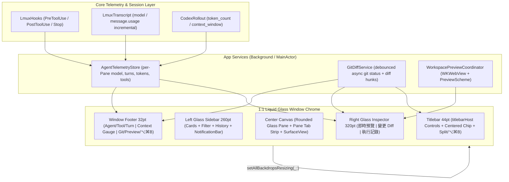

# 正式 App 1:1 Apple Liquid Glass 雙欄工作台與 Core 遙測管線 — 技術設計

## Approach

本設計在保留根目錄設計原型 [preview-mockup.html](../../../preview-mockup.html) 作為驗收與視覺對照基準的前提下，從 `Core/` 資料層到 `App/` 三欄原生介面全面實現 1:1 的 Apple Liquid Glass 工作台，同時延續 lmux「不包裹 CLI、只旁聽並以 AppKit/Metal 呈現極致流暢終端機」的核心架構。

### 1. Core Telemetry 擴充（`Core/LmuxHooks` + `Core/LmuxTranscript`）
- **資料模型（`Core/Sources/LmuxTranscript/AgentTelemetry.swift` 等）**：
  - `AgentTelemetrySnapshot`：`model: String?`、`turnCount: Int`、`contextUsedTokens: Int`、`contextLimitTokens: Int`、`inputTokens: Int`、`outputTokens: Int`、`cacheCreationTokens: Int`、`cacheReadTokens: Int`、`estimatedCostUSD: Double?`、`contextPercent: Double`、`updatedAt: Date?`。
  - **Claude JSONL 增量抽取**：擴充 `TranscriptIndex`（並透過 `TranscriptCache.Snapshot` 暴露給 UI）在增量掃描 `assistant` 條目時讀取 `message["model"]` 與 `message["usage"]`（`input_tokens`、`cache_read_input_tokens`、`cache_creation_input_tokens`、`output_tokens`），算出目前 Context 佔用與快取命中率，並依模型家族對應預設 Context 上限（如 Claude 200k / 1M）與費率估算。對無 `usage` 欄位或半行損毀的 JSON 安全略過，絕不崩潰或產生負值。
  - **Codex Rollout 增量抽取**：擴充 `CodexRollout`（及 `CodexRollout.Parsed`）在 `classify(o)` 前解析 `session_meta` / `turn_context`（`model`）與 `token_count`（`model_context_window`、`last_token_usage`），統一匯入 `AgentTelemetrySnapshot`。
- **即時 Tool Call 串流（`Core/Sources/LmuxHooks/ToolCallStream.swift` + `AgentState.swift` / `LmuxUI/Agent.swift`）**：
  - `HookEvent` 在 `PreToolUse`、`PostToolUse`、`PostToolUseFailure` 已有 `toolName`、`toolArgument`、`toolUseID`、`sentAtNanos`（搭配 `receivedAtNanos` fallback）。
  - 在 `PaneAgent` 維護上限 50 筆的 `ToolCallStream`（`entries: [ToolCallEntry]`，含 `id`、`name`、`category` [`read`/`edit`/`bash`/`search`/`other`]、`argument`、`startedAtNanos`、`durationMs: Int?`、`status`）；同時補齊 `Agent.swift` 中 Codex `codexReport` early-return 路徑，確保 Codex 工具事件也送入 `ToolCallStream`。

### 2. 背景 `GitDiffService` 與檔案掃描（`App/Sources/LmuxUI/GitDiffService.swift`）
- 追蹤目前選取 `Workspace` 的作用目錄（取 `focusedPane?.cwd` 或最近已知有效目錄），切換 **workspace** 或收到 Hook／檔案觸發時在背景佇列 debounce（200ms）以直接 `/usr/bin/git` `Process`（禁用 shell、帶 `--no-ext-diff --no-textconv -c core.fsmonitor=false --`、`GIT_OPTIONAL_LOCKS=0`、concurrent pipe 讀取、硬性位元組與行數上限、timeout 與 `process.terminate()` 取消機制）執行 `rev-parse`、`branch --show-current`、`status --porcelain=v1 -z`、`diff --numstat` 與 `diff --unified=3`（包含 unborn HEAD fallback），並用 `PreviewTarget.replacingUnsafeScalars` 過濾路徑。
- 發布 `@Observable` `GitDiffSnapshot`：`cwd: String?`、`isGitRepo: Bool`、`branch: String?`、`totalAdded: Int`、`totalDeleted: Int`、`files: [GitDiffFile]`、`previewCandidates: [URL]`（以 `PreviewTarget.resolve` 驗證之一般檔案清單）。非 Git 目錄設定 `isGitRepo = false`，讓 **右側 Inspector** 與 **底部狀態列** 呈現清晰空狀態。

### 3. 1:1 Apple Liquid Glass Token（`App/Sources/LmuxTokens/Tokens.swift`）
- 對照 [preview-mockup.html](../../../preview-mockup.html) 重調淺色（High-Key Crystal）與深色（Obsidian Midnight）全套色彩與版面常數：
  - **標題列與雙側邊欄玻璃**：新增 `windowBackgroundTint`、`titlebarBackground`、`rightSidebarTint`、`footerBackground`、`glassCard`、`glassCardHover`、`glassCardSelected`、`glassSurfaceRecessed`、`activePaneRing`（`0x0A84FF`），更新 `sidebarTint`、`specularHighlight`；既有 `glassBorder` 保留給傳統邊線呼叫點相容檢查，並新增 `glassHighlightBorder` 供 1:1 淺色高透白邊與深色亮邊卡片使用。
  - **狀態藥丸與 Diff 色彩**：`statusRunningPill`/`Text`、`statusNeedsInputPill`/`Text`、`statusDonePill`/`Text`、`statusIdlePill`/`Text`、`diffAddedBg`/`Fg`、`diffRemovedBg`/`Fg`。
  - **尺寸常數**：`titlebarHeight = 44`、`footerHeight = 32`、`sidebarWidthDefault = 260`（180–400）、`rightInspectorWidthDefault = 320`（240–500）、`paneCornerRadius = 10`、`paneGap = 8`、`paneTabStripHeight = 30`、`workspaceFilterHeaderHeight = 30`。
  - **對比與降級**：保留 `AccessibilityTests` / `liquid-glass-app-check` 對全部選取列、狀態藥丸、搜尋框、Diff 標籤與 **底部狀態列** 文字對比 >= 4.5:1 的檢核；`accessibilityDisplayShouldReduceTransparency` 與 `Motion.reduceMotion` 全域生效（含測試專用 `reduceMotionOverride`）。

### 4. 三欄＋狀態列視窗骨架與 1:1 原生元件（`App/Sources/LmuxUI/` + `LmuxNotificationBar/`）
- **`RootView.swift` 視窗版面引擎**：
  - 全域最上方為統一的 **`44pt` Glass Titlebar**：可視化玻璃背景與置中 `TitlebarCenterChip`、左右操作群組皆正確整合至 AppKit `titlebarHost` 層級（確保滑鼠點擊命中且不阻擋標題列拖曳；保留與更新 `root.header` / `TitlebarCluster` 相容介面與 `modeBadge`、`zoomIcon` 支援）。左側維持紅黃綠燈、左側欄開關（`⌘B` / `⌃⌘S`）、鈴鐺與未讀角標、`+` 新增 **workspace**；中央為置中 `TitlebarCenterChip`；右側為 `TitlebarRightCluster`（`⌘D`、`⇧⌘D`、`⌥⌘B`）。
  - 最下方保留完整 **`32pt` Glass Window Footer（`WindowFooterView`）**，左右對齊 `bounds.width`，所有 Chrome hosting view 皆強制使用 `SidebarHostingView`（`acceptsFirstResponder == false`）。
  - 中間區塊 (`H = totalHeight - titlebar - footer`) 由左至右為：
    1. 左側邊欄：`SidebarBackdrop` + 位於 `sidebarHost` 上方之 `WorkspaceFilterHeader`（保持 `sidebarHost` 內部列起始偏移相容）+ `SidebarView`（卡片 + History 搜尋列）+ `NotificationBar`（`SidebarAccessory` 計入 `footerHeight` 與 `workspaceFilterHeaderHeight` 高度預算）+ `SidebarResizeHandle`。
    2. 中央終端畫布：窄視窗（如 `600×360` / `420×260`）自動依序暫時折疊右側 Inspector／鉗製側欄寬度以維持至少 `120pt` 終端可用寬度；內部配置帶 `paneGap` 之圓角分割窗格。
    3. 右側調整手把 `RightInspectorResizeHandle` + **右側 Inspector**（`RightInspectorBackdrop` + `RightInspectorView`，預設展開，寬度持久化於 `layout.json`）。
- **Workspace 卡片重構（`Sidebar.swift`）**：
  - 卡片改為圓角 `8pt` 玻璃卡片，左側 `3pt` 垂直 Accent 條（與 `TabDisclosureButton` 水平座標錯開不重疊），第 1 行左側標題／右側狀態藥丸（`⚡ 執行中` / `🔔 需要確認` / `✓ 測試通過` / `閒置`；hover 時保留快速關閉 ×），第 2 行左側最新 agent 摘要／目錄、右側相對時間。
  - **100% 保留** `SidebarTabChildren`（Tab 子樹展開）、`⌘`/`⇧` 多選、`SidebarRowMotion` 拖曳重排（`workspaceFilter != .all` 時顯示提示並停用拖曳重排與無結果空狀態）與右鍵選單，加上標題列篩選（全部／進行中／需要確認）。
- **History 與 NotificationBar（`History.swift`、`NotificationBar.swift`、`NotificationCard.swift`）**：
  - `HistorySection` 固定置於 Workspace 清單底部、**通知 bar** 上方，採用玻璃膠囊搜尋框（`⇧⌘H` 快捷與既有搜尋結果清單向上／浮層展開不遮擋下方通知列）。
  - `NotificationBar` 呈現圓角玻璃配件框（上緣 `6pt` 膠囊拖曳把手、Inbox 標題＋鈴鐺紅點＋未讀藍數膠囊＋可點擊摘要列收合 `BarLayout.isCollapsed` 與下拉過低自動收合閾值、圓角玻璃 **通知卡片** 含未讀藍點、標題、經過時間、`workspace · branch` 與兩行摘要）。
- **中央圓角分塊與 `Pane Tab Strip`（`PaneViews.swift`、`Tabs.swift`）**：
  - 每個終端分割葉節點改包進帶有圓角 `10pt`、`1px` 玻璃邊框與聚焦 `active-ring` 藍光邊框的容器內（與非焦點待輸入 `RingView` 琥珀色明確區別）。
  - 上方統一渲染 **`Pane Tab Strip`（`30pt`）**，左側列出分頁膠囊（活躍狀態亮點、標題、關閉 `×`）與 `+` 開分頁鈕，右側列出向右分割、向下分割與關閉分塊鈕；既有分頁拖拽重排／跨格分割、雙擊改名、點選切換與 `libghostty` 鍵盤轉發維持完整行為。
- **右側 Inspector（`RightInspectorView.swift`、`InspectorDiffView.swift`、`InspectorTraceView.swift`、`InspectorPreviewPane.swift`）**：
  - Segmented Control 切換三個分頁：
    - **即時預覽**：透過 `WorkspacePreviewCoordinator` 管理目前預覽檔與單一乾淨重設/隔離之 `PreviewView`（切換 **workspace** 時明確 `close()` 並重建以免殘留 `backForwardList`/`PreviewWatcher`），提供位址控制列（`‹` `›` `↻`、檔案圖示、目前相對路徑、`LIVE` 綠色標籤、透過 `GhosttyRuntime.openTerminalURL` 安全外開之 `↗`）、快速檔案 chip 列與底部狀態列（`WKWebView Pipeline (Metal)` / `Auto-reload on save`）；並更新 `Controller.ensureFocus()` 允許 `Inspector` `.preview` 中的 `WKWebView` 保留焦點，隱藏或切離分頁時呼叫 `focusCurrent()`。
    - **變更 (Diff)**：Working Tree 摘要卡片（分支、檔案數、`+adds -dels`）+ 逐檔 Diff 卡片（紅刪除 `-` / 綠新增 `+` monospace 等寬列）；點擊檔案標題經 `PreviewTarget.resolve` 檢查後切入「即時預覽」；非 Git 目錄顯示空狀態。
    - **執行記錄**：Card 1「Context Window (Token 負載)」（百分比徽章、藍紫漸層進度條、已用/上限、2×2 明細：輸入 Input、輸出 Output、快取命中 Cache、估計費用）；Card 2「最近執行的工具 (Tool Calls)」即時串流列表；無作用中 Agent 顯示清楚空狀態。
- **全域 `拖曳降級` 協調**：
  - 左側欄寬度、`右側 Inspector` 寬度、**通知 bar** 高度、`SplitContainerView` 分割線及 `NSWindow` live resize 皆透過 `RootView.setAllBackdropsResizing(_:)`（含 `SidebarAccessory.setSidebarResizing(_:)` 轉發）同步切換左／右／頂／底四個 `NSVisualEffectView` 背景為 `isResizing = true`，並保留 `didResignKey`、`didResignActive`、`@GestureState` 與 `viewWillMove(toWindow: nil)` 全方位自動清理。

---

## Key Decisions

1. **雙軌預覽模型（Right Inspector Live Preview + Split Preview Tab）** — 詳見 [docs/adr/0002-dual-track-inspector-preview.md](../../../docs/adr/0002-dual-track-inspector-preview.md)。
   - **開啟選單**第一項新增「在右側欄即時預覽」，保留「在新 tab 預覽」；同時按住 `⌃⌘` 點擊終端機路徑可略過選單直接開成 **預覽 tab**。
2. **單層 Backdrop Material 搭配半透明覆層與 `拖曳降級` 守護** — 詳見 [docs/adr/0003-single-backdrop-glass-simulation.md](../../../docs/adr/0003-single-backdrop-glass-simulation.md)。
   - 僅大面板底層掛載 `NSVisualEffectView`，清單卡片與分頁以半透明色票＋高光邊框實現同等視覺，拖曳時全面轉不透明實底。
3. **Hook 即時事件 + JSONL 增量解析雙軌收集 Agent 遙測** — 詳見 [docs/adr/0004-hybrid-hook-and-jsonl-telemetry.md](../../../docs/adr/0004-hybrid-hook-and-jsonl-telemetry.md)。
   - 確保工具狀態毫秒級反映，同時具備模型／Token／Cache／費用精確統計，無需輪詢外部程式。
4. **相容既有關閉與快速鍵習慣**：
   - `⌘B`（與原型一致）與既有 `⌃⌘S` 皆綁定左側欄開關；`⌥⌘B` 綁定 **右側 Inspector** 開關；`layout.json` 新增之 `inspectorVisible`、`inspectorWidth`、`inspectorTab` 為 optional 欄位，舊版檔案預設展開顯示 `preview`（`320pt`）。

---

## Components

| 檔案 / 模組 | 職責與改動重點 |
|---|---|
| `Core/Sources/LmuxTranscript/AgentTelemetry.swift`、`TranscriptIndex.swift`、`CodexRollout.swift` | 增量抽取 Claude `model`/`usage` 與 Codex `token_count`/`model_context_window`，定義 `AgentTelemetrySnapshot` 與容錯測試。 |
| `Core/Sources/LmuxHooks/ToolCallStream.swift`、`AgentState.swift` | 擴充工具呼叫開始／結束／失敗追蹤結構（`ToolCallEntry` / `ToolCallStream`）與 Turn 計數統計，支援即時串流。 |
| `App/Sources/LmuxTokens/Tokens.swift`（與 `design/Tokens.swift`） | 實作 1:1 淺／深雙主題 Liquid Glass 色彩、尺寸（`44/32/260/320`）、圓角、光暈邊框與狀態藥丸色票。 |
| `App/Sources/LmuxUI/GitDiffService.swift` | 背景安全非同步執行 `git status` / `git diff`，彙整分支、增刪行總計、Diff hunks 與經 `PreviewTarget` 驗證之可預覽檔案清單。 |
| `App/Sources/LmuxUI/AgentTelemetryStore.swift`、`MessageActions.swift`、`Agent.swift` | 彙整 Hook（含 Codex tool events）與 `TranscriptCache` 增量結果，提供 per-Pane／per-Workspace 模型、Turn、Token 與 Tool Calls。 |
| `App/Sources/LmuxUI/RootView.swift`、`WindowFooterView.swift`、`TitlebarView.swift`、`SidebarAccessory.swift` | 重構為 `titlebarHost` 整合之 44pt Titlebar + 窄視窗保護三欄工作區 + 32pt 全寬 **底部狀態列**，統一 `setAllBackdropsResizing(_:)` 協調。 |
| `App/Sources/LmuxUI/Sidebar.swift`、`History.swift`、`HooksSetup.swift` | 升級 **workspace** 玻璃卡片（垂直色條、狀態藥丸、篩選鈕，保留多選／拖曳／子樹）；將 History 搜尋移動至 **通知 bar** 上方。 |
| `App/Sources/LmuxUI/PaneViews.swift`、`Tabs.swift`、`Snapshot.swift` | 升級中央分割葉為 `10pt` 圓角卡片 + Focus `active-ring` 藍光與整合式 **Pane Tab Strip**。 |
| `App/Sources/LmuxUI/RightInspectorView.swift`、`InspectorDiffView.swift`、`InspectorTraceView.swift`、`InspectorPreviewPane.swift`、`OpenMenu.swift`、`Persistence.swift` | 實作 **右側 Inspector** 三分頁（含 `WorkspacePreviewCoordinator`、`PreviewView` 乾淨隔離、`Diff`、`執行記錄`）；更新 **開啟選單**（`GhosttyRuntime.openTerminalURL` 安全外開）與持久化欄位。 |
| `App/Sources/LmuxNotificationBar/NotificationBar.swift`、`NotificationCard.swift` | 調整 **通知 bar** 為玻璃圓角配件、未讀藍點、摘要列折疊切換與鐘形紅點回饋，同步全域 `setSidebarResizing` 降級。 |
| `Core/Tests/`、`App/Sources/lmux-apptest/`、`App/scripts/` | 補齊 Telemetry 單元測試、更新 `OpenMenu`/`PaneTabs`/`Titlebar` 相容測試、加入 `ReduceMotion`/`ReduceTransparency` 與實機雙主題截圖／還原驗收。 |
