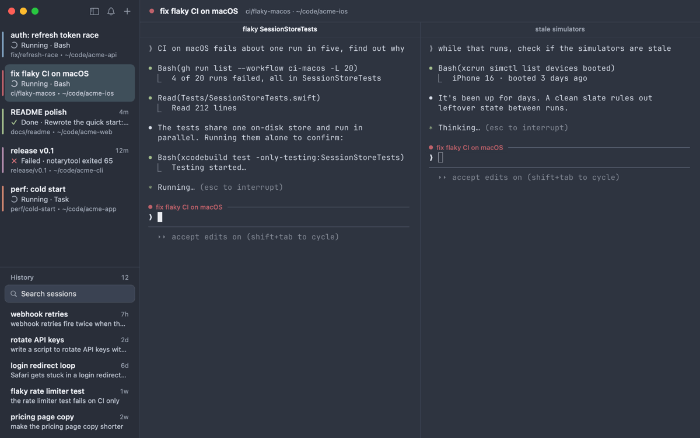
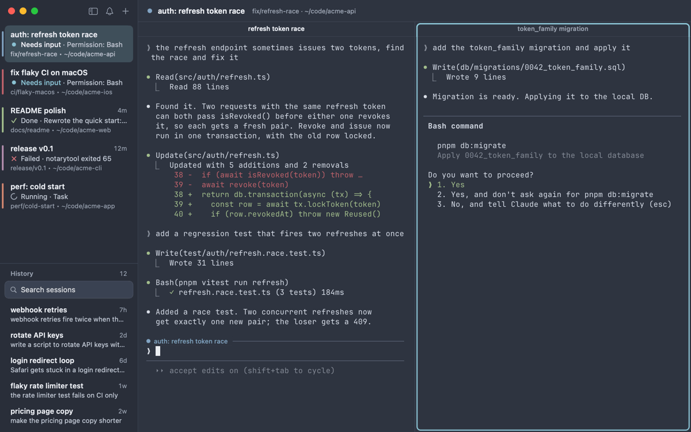
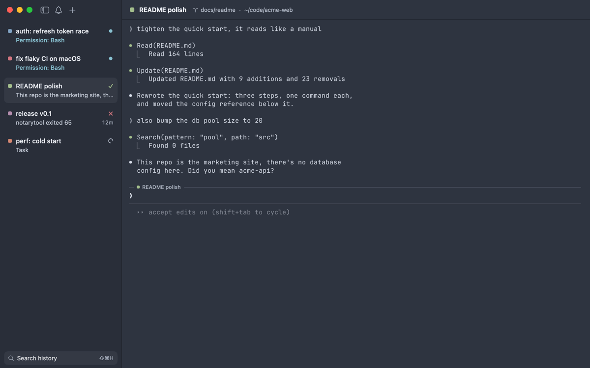
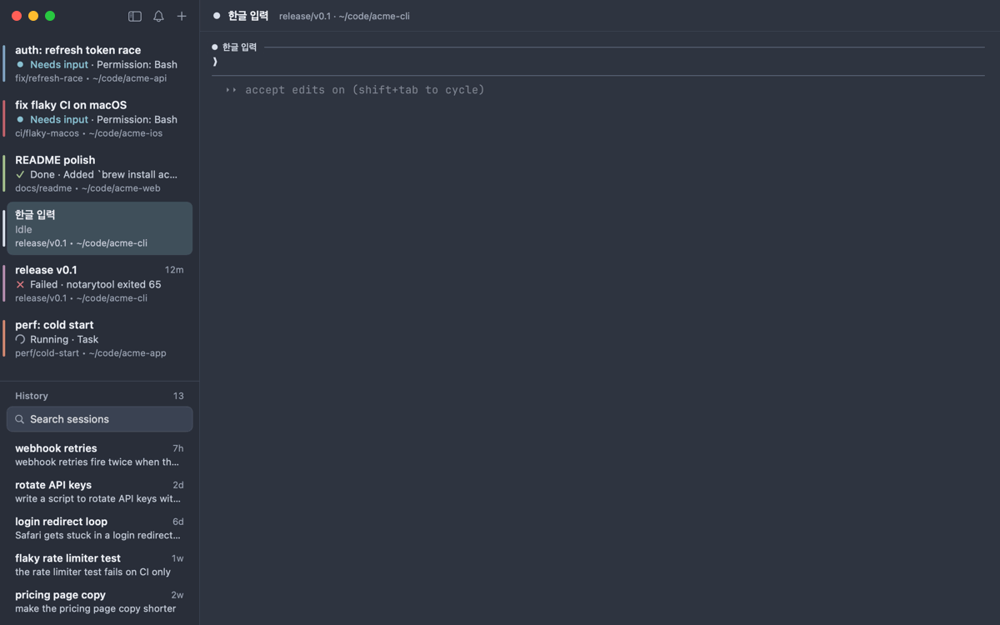

# A Quick Tour

Recorded from the real app. The Claude Code sessions are replayed, so no tokens were spent. Codex side by side with Claude, `⇧⌘↩` zoom and dragging a row are in the video at the top of [lmux.dev](https://lmux.dev/).

**An agent needs you.** A ring on the pane, a badge on the workspace, and ⇧⌘J takes you straight there.

**That session from last week.** Type a word, see where you said it, press Enter, and you're back in it.

**Oops, wrong session.** Hover, `×`, confirm. Claude rewinds to just before that prompt, in the same session, as if you'd never sent it. (Claude Code only.)

**Korean, typed fast.** Hit Enter while the last syllable is still composing, and nothing gets eaten.

